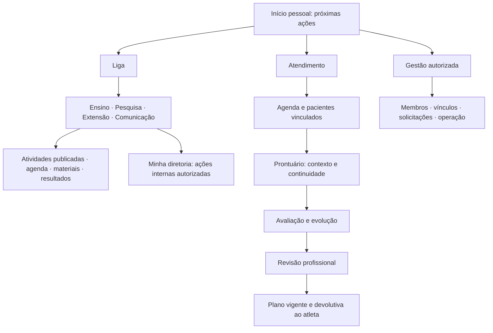

# Proposta de atualização — fechamento da versão LAINES

## Resultado pretendido

Uma pessoa entra, entende seu papel, encontra a próxima ação e conclui a tarefa com confiança. Um aluno acompanha a liga inteira e atua apenas onde tem responsabilidade. O atendimento conecta avaliação, revisão, plano e orientação ao atleta, com o mesmo dado na tela, no servidor e no documento entregue.

**A proposta não depende de ampliar o cadastro clínico.** Reaproveita informações, instrumentos e componentes existentes. Pequenos metadados técnicos de versão, autoria e estado servem para integridade e não devem virar formulários adicionais para alunos ou pacientes.

## Organização do produto

São agrupamentos de navegação e projeções dos registros atuais. Não é necessário criar três sistemas, novas bases ou um módulo de gestão paralelo.

### Quem vê e quem atua

| Pessoa / contexto | Visão da Liga | Ação em diretoria | Atendimento clínico | Aprovação/publicação clínica |
|---|---|---|---|---|
| Aluno sem diretoria | Atividades publicadas das quatro diretorias | Participação permitida, sem gestão interna | Somente pacientes/vínculos autorizados | Elabora e encaminha; não assume autoria profissional |
| Aluno de diretoria | Mesma visão transversal | Sua diretoria, segundo capacidade atribuída | Mesmo critério de vínculo do aluno sem diretoria | Igual ao aluno sem diretoria |
| Presidente / vice | Visão institucional ampliada e gestão acadêmica atribuída | Conforme atribuição explícita | Cargo acadêmico não concede acesso clínico global automaticamente | Depende de habilitação e responsabilidade clínica, não do cargo |
| Professor / profissional | Conteúdo acadêmico pertinente | Conforme atribuição | Equipe/pacientes supervisionados e competências atribuídas | Responsável autorizado, na versão exata do registro |
| Pesquisador / colaborador | Projetos e conteúdo pertinente | Conforme atribuição | Somente finalidade e escopo autorizados; agregados por padrão em pesquisa | Não por simples pertencimento ao perfil |
| Equipe técnica | Conteúdo e acompanhamento pertinentes | Sem gestão implícita | Projeção necessária ao acompanhamento dos vinculados | Não por simples pertencimento ao perfil |
| Atleta | Conteúdo destinado ao atleta | Nenhuma gestão | Próprio acompanhamento, dados e orientações disponibilizados pelo fluxo | Consulta plano vigente; não altera prescrição |
| Administrador técnico | Gestão de contas/configuração | Conforme atribuição | Evitar que administração técnica seja permissão clínica implícita; exceção definida e auditada | Não assina como profissional sem atribuição correspondente |

Esta é uma **matriz proposta**, não uma descrição da autorização atual. Deve virar regra única no servidor, com teste por objeto, campo e canal. A interface usa essas capacidades para oferecer ações coerentes. O acesso técnico de emergência, se necessário pela operação institucional, deve ter finalidade, escopo e trilha próprios.

## O que manter, fundir e tirar do primeiro plano

| Área atual | Manter | Reorganizar / reduzir |
|---|---|---|
| Diretorias | Conteúdos, projetos, ideias, materiais e agenda existentes | Uma visão comum de publicações; edição/fila interna local. Incluir Comunicação na navegação transversal sem criar obrigação de novos relatórios manuais. |
| Início | Próximas consultas, vínculos e pendências reais | Uma fila pessoal, até poucos indicadores relevantes. Calendário completo fica na agenda. |
| Prontuário | Histórico, avaliações, anexos, evolução e vínculo assistencial | Cabeçalho compacto; uma próxima ação; avisos duplicados fundidos; instrumentos opcionais fora da contagem de atraso. |
| Avaliações | Instrumentos existentes, normalização e origem | Seções progressivas, leitura anterior junto ao campo pertinente e resultado separado da coleta. Sem exigir todos os instrumentos por padrão. |
| Prescrição | Refeições, medidas, catálogo, substituições, totais e orientações | Um contrato de dados; editor principal e análise secundária; revisão, PDF e entrega ligados à mesma versão. |
| Professor | Supervisão e visão de equipe | Fila de avaliações/planos a revisar antes dos contadores gerais. |
| Atleta | Cadastro, pendências e acompanhamento | Plano vigente e instruções claras no acompanhamento; evitar reapresentar dados técnicos sem finalidade. |
| Relatórios | Indicadores com fonte/período/população | Visão inicial pelo papel; tabelas e valores originais disponíveis; exportação identificada com autorização própria. |

## Prescrição pronta de ponta a ponta

1. **Abrir paciente:** reutilizar peso, contexto, restrições e última avaliação elegível. Mostrar de onde vêm os valores e quando foram registrados. Quando insuficientes, indicar a lacuna sem preencher automaticamente com zero ou referência genérica.
2. **Montar refeições:** busca, porções, horários, orientações e alternativas. Restrição confirmada participa das sugestões. Preservar alimentos manuais e snapshot de composição com origem identificada.
3. **Conferir:** total do dia e por refeição, unidades, cobertura, meta e referência separadas. Arredondamento no ponto correto e mesmo motor/contrato no servidor. Análises avançadas expandíveis.
4. **Salvar rascunho:** retorno persistente e round-trip sem perda, inclusive para planos antigos. Conflito de edição deve evitar sobrescrita silenciosa.
5. **Revisar:** encaminhamento ao responsável; aprovação vinculada à sessão e versão. Mudança clínica relevante após aprovação exige revisão nova.
6. **Publicar:** tornar vigente pelo fluxo autorizado, preservando histórico. Somente a versão aprovada aparece como plano atual para o atleta.
7. **Entregar:** portal e PDF com os mesmos alimentos, medidas, substituições, orientações, responsável e data. “Gerar” precisa executar uma função existente e verificável ou sair da versão; não é justificativa para acrescentar prescrição automática por IA.

Não há necessidade de pedir nova anamnese para montar o plano. O problema é conectar os dados que já estão no sistema.

## Padrões de informação

**Gráfico:** responder a uma pergunta, com data, unidade, origem, método e indicação de dado ausente/estimado. Preservar a separação por unidade já implementada em evolução. Detalhes por toque/teclado e alternativa em tabela. Uma cor não é evidência de melhora clínica.

**Tabela:** título, unidade no cabeçalho, filtro, ordenação, quantidade de resultados, paginação e ações previsíveis. No celular, rolagem de tabela contida na própria região quando indispensável; o resto da página permanece legível.

**Formulário:** mostrar a seção atual, reutilizar cadastro/histórico e permitir salvar rascunho coerente. Erro junto ao campo e síntese de pendências; não repetir explicação técnica em todas as seções. Supervisão/projeto obrigatórios para uma ação clínica não devem bloquear o aluno que só está consultando a Liga.

**Estado vazio:** diferenciar sem registro, não solicitado, não aplicável, aguardando resposta e erro de carregamento. Um card com zero não pode comunicar automaticamente normalidade ou atraso.

## Ordem de execução

| Onda | Entrega | Critério para avançar |
|---|---|---|
| 0 — estabilizar e proteger | UPD-01 a 08: autenticação, WebSocket, exportação, upload, inscrição, contrato de plano, autoria e CI | Reproduções P0 deixam de ocorrer; pipeline executável; dados legados preservados. |
| 1 — concluir atendimento | UPD-09 a 12, 17 e 20 em suas dependências: bibliotecas, prescrição/entrega, referências, autorização, supervisão e testes | Um caso sintético percorre criação → revisão → plano → PDF → atleta com valores iguais e escopos corretos. |
| 2 — organizar experiência | UPD-13 a 16 e 18: navegação, prontuário, gráficos/tabelas, mobile e continuidade | Aluno de qualquer diretoria encontra leitura transversal; ações internas restritas; atendimento sem avisos duplicados ou perda de contexto. |
| 3 — homologar e fechar | UPD-19, 21 e 22; UPD-23/24 conforme risco e impacto no fechamento | Documentação atual, backup/restore comprovado, ambiente final validado e limites da avaliação experimental explícitos. |

Mobile e acessibilidade podem começar em paralelo à onda 0. Refinamento de componentes pode acompanhar cada entrega. A ordem é por dependência/risco; não é uma estimativa fechada de calendário. Produto, backend, frontend, responsável clínico e operação devem revisar o resultado pertinente, sem criar uma cadeia de aprovações para cada alteração cosmética.

## Backlog rastreável

Todos os itens abaixo estão **propostos**, não implementados por esta auditoria. O [backlog estruturado](backlog.json) inclui entrega, aceite, dependências e esforço relativo. Esforço M/G representa tamanho comparativo, não dias contratados.

| Item | Prioridade | Entrega | Achados | Depende de |
|---|---|---|---|---|
| UPD-01 | P0 | Recuperação e credenciais | SEC-01, SEC-02 | — |
| UPD-02 | P0 | Eventos clínicos e sessão | SEC-03, SEC-04 | — |
| UPD-03 | P0 | Relatórios e exportações | SEC-06, SEC-07 | — |
| UPD-04 | P0 | Upload de conteúdo | SEC-08 | — |
| UPD-05 | P0 | Inscrição duplicada | SEC-05 | — |
| UPD-06 | P0 | Contrato e migração da prescrição | CLI-01, CLI-02, CLI-08 | — |
| UPD-07 | P0 | Revisão e autoria | SEC-09, CLI-04 | UPD-06 |
| UPD-08 | P0 | Pipeline de publicação | ENG-01 | — |
| UPD-09 | P1 | Dependências | ENG-03 | UPD-08 |
| UPD-10 | P1 | Emitir e entregar plano | CLI-03 | UPD-06, UPD-07 |
| UPD-11 | P1 | Referências e restrições | CLI-05, CLI-06, CLI-07, CLI-09 | UPD-06 |
| UPD-12 | P1 | Contrato de autorização | SEC-03, SEC-06, UX-04 | UPD-02, UPD-03 |
| UPD-13 | P1 | Navegação da liga | UX-04, UX-05 | UPD-12 |
| UPD-14 | P1 | Prontuário e pendências | UX-02, CLI prontuário | UPD-12 |
| UPD-15 | P1 | Gráficos e tabelas | CLI-06, CLI-07, UX-08 | UPD-11 |
| UPD-16 | P1 | Mobile e acessibilidade | UX-01, UX-03, UX-08 | — |
| UPD-17 | P1 | Supervisão por jornada | UX-06, CLI revisão | UPD-07, UPD-14 |
| UPD-18 | P1 | Contexto e preenchimento | UX-07, CLI cadastro | UPD-13 |
| UPD-19 | P1 | Documentação e organização | ENG-08 | UPD-12 |
| UPD-20 | P1 | Testes de jornadas | ENG-02 | UPD-01, UPD-02, UPD-03, UPD-04, UPD-05, UPD-06, UPD-07, UPD-10 |
| UPD-21 | P1 | Homologação e restauração | ENG-06 | UPD-08, UPD-09, UPD-20 |
| UPD-22 | P1 | Imagem experimental | CLI imagem | UPD-12 |
| UPD-23 | P2 | PWA e desempenho | ENG-05, ENG-07 | UPD-18 |
| UPD-24 | P2 | Consistência e dívida de UI | ENG-04, UX-05, UX-06, UX-09 | UPD-13, UPD-14, UPD-15, UPD-16 |

## Critérios de fechamento da versão

- Nenhum P0 aberto; P1 de jornada essencial, privacidade e operação resolvido antes do uso final. P2 pode ser planejado separadamente quando não inviabilizar a experiência.
- Login, recuperação, refresh, logout e revogação consistentes em HTTP e socket.
- Leitura acadêmica transversal e edição local verificadas com aluno sem diretoria, de sua diretoria e de outra diretoria.
- Pacientes, avaliações, anexos, imagens, planos, PDFs e eventos respeitam vínculo e finalidade; URL ou payload não ampliam acesso.
- Plano novo e legado preservam dados; revisão tem autoria real; versão entregue ao atleta coincide com a do servidor/PDF.
- Referências e restrições usam os dados elegíveis; nulo não vira zero; estimativa não vira medida validada.
- Jornada essencial utilizável em celular e teclado; nenhum menu cobre conteúdo; ações anunciadas produzem efeito.
- Testes obrigatórios sem skip, lint/CI válidos e dependências com situação documentada.
- Implantação, migração e restauração de banco/arquivos ensaiadas; release e documentação identificáveis.

## Controle de risco da atualização

Começar com uma fotografia de banco e arquivos em ambiente controlado e uma revisão imutável do código. Migrar planos de modo compatível, comparar antes/depois e manter rollback. Publicar mudanças de contrato em conjunto com os consumidores. Não fazer limpeza destrutiva dos artefatos locais nem reformatar toda a base enquanto os fluxos críticos estiverem mudando.

A validação de fechamento deve gerar evidências novas; esta auditoria é a linha de base dos problemas, não uma aprovação de produção.
